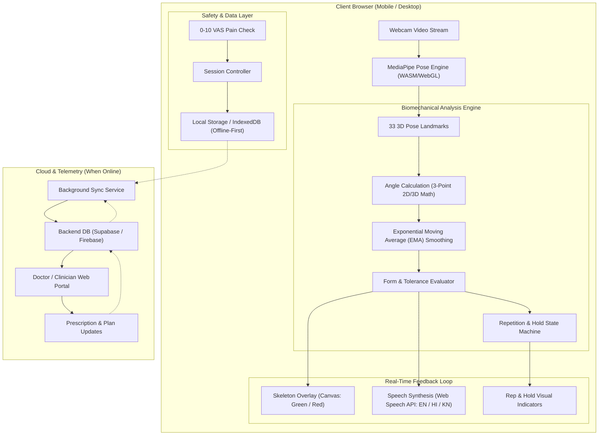
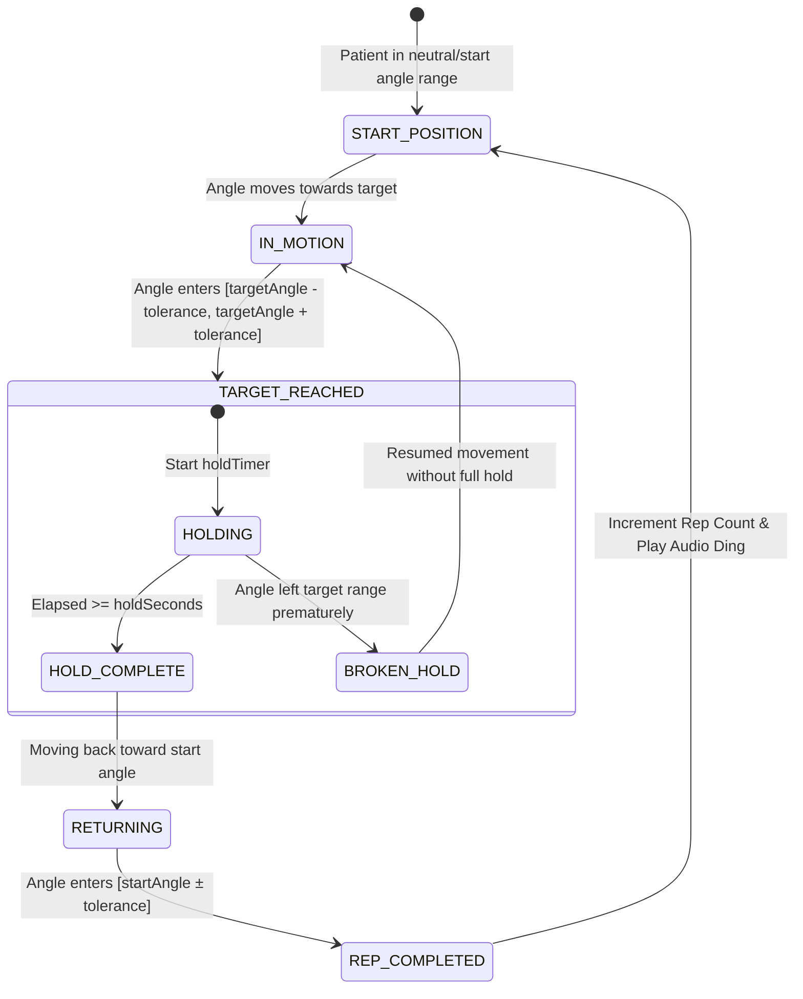

# System Architecture & Technical Design: RehabBuddy

## 1. System Overview & Architecture Diagram

RehabBuddy is an **offline-first, client-side progressive web application**. Heavy computer vision inference runs entirely on the user's client hardware (CPU/GPU via WebAssembly and WebGL), preserving patient privacy and allowing operation with intermittent or zero internet connectivity.



---

## 2. Client-Side Processing Pipeline

The frame-by-frame loop runs in the browser via `requestAnimationFrame`:

```
Webcam Frame (30 FPS)
  │
  ▼
MediaPipe Pose (Inference ~15-30 FPS)
  │
  ▼ Extract Landmarks (x, y, z, visibility)
Biomechanical Math (Joint Angle: A-B-C)
  │
  ├──► Landmark Visibility Check (visibility > 0.65 threshold)
  │      └── False: Trigger "Camera Alignment / Step Back" cue
  │
  ├──► Smooth Angle = α * Angle_new + (1 - α) * Angle_prev (EMA smoothing, α = 0.35)
  │
  ├──► Compare Angle to Exercise Spec [targetAngle ± tolerance]
  │
  ├──► Render Skeleton Canvas (Color: Green if within form tolerance, Red if deviant)
  │
  ├──► Update Finite State Machine (IDLE -> MOVING -> HOLDING -> RETURNING -> COUNTED)
  │
  └──► Throttle Audio TTS (Max 1 cue per 2.5 seconds to prevent spam)
```

---

## 3. Mathematical Foundations

### 3.1 3-Point Joint Angle Calculation
For any joint $B$ (vertex) connected to adjacent joints $A$ and $C$:
- Vector $\vec{u} = \vec{A} - \vec{B} = (x_A - x_B, y_A - y_B)$
- Vector $\vec{v} = \vec{C} - \vec{B} = (x_C - x_B, y_C - y_B)$

The planar joint angle $\theta$ (in degrees) is calculated using `Math.atan2`:
$$\theta = \left| \operatorname{atan2}(v_y, v_x) - \operatorname{atan2}(u_y, u_x) \right| \times \frac{180}{\pi}$$
$$\text{If } \theta > 180^\circ \implies \theta = 360^\circ - \theta$$

### 3.2 Temporal Smoothing (Jitter Suppression)
Pose landmarks inherently exhibit micro-jitter due to camera noise and light fluctuation. An Exponential Moving Average (EMA) or Low-Pass filter is applied:
$$\theta_{\text{smoothed}}^{(t)} = \alpha \cdot \theta^{(t)} + (1 - \alpha) \cdot \theta_{\text{smoothed}}^{(t-1)}$$
Recommended parameter: $\alpha = 0.35$ (balances responsiveness with jitter suppression).

---

## 4. Repetition & Hold State Machine



### State Definitions:
1. `IDLE / ALIGNMENT`: Verifying key landmark visibility ($> 0.65$) and initial patient stance.
2. `START`: Joint angle is at initial position ($startAngle \pm tolerance$).
3. `INFLECTION`: Joint angle approaches target. Real-time form checks verify secondary joint stability (e.g., during elbow bend, shoulder remains steady).
4. `HOLD`: If $holdSeconds > 0$, starts countdown. Visual circular progress indicator fills.
5. `RETURN`: User returns joint to start position.
6. `COMPLETED`: Rep logged with accuracy score:
   $$\text{Accuracy}_{\text{rep}} = 100 - \left( \frac{|\theta_{\text{achieved}} - \theta_{\text{target}}|}{\text{tolerance}} \times 20 \right)$$

---

## 5. Offline-First Data Architecture & Cloud Sync

### 5.1 Local Storage Schema (IndexedDB / LocalStorage)
```typescript
interface SessionRecord {
  sessionId: string;
  patientId: string;
  exerciseId: string;
  timestamp: number; // Unix timestamp
  prePainRating: number; // 0 to 10
  postPainRating: number; // 0 to 10
  repsTarget: number;
  repsCompleted: number;
  averageAccuracy: number; // 0 - 100%
  repDetails: Array<{
    repNumber: number;
    maxRomAngle: number;
    targetAngle: number;
    holdDuration: number;
    formScore: number;
    timestamp: number;
  }>;
  abortedPrematurely: boolean;
  abortReason?: "HIGH_PAIN" | "USER_QUIT" | "ALIGNMENT_LOST";
  synced: boolean;
}
```

### 5.2 Synchronization Protocol
1. Client writes every session immediately to local storage (`synced: false`).
2. A `navigator.onLine` listener and periodic retry worker detect network availability.
3. When connected, pending sessions are batched and posted to cloud database (Supabase / Firebase).
4. Response updates local records to `synced: true`.
5. Doctor portal queries synced cloud records to populate clinical progress charts.

---

## 6. Doctor & Patient View Segregation

```
┌────────────────────────────────────────────────────────┐
│                      RehabBuddy                        │
├──────────────────────────┬─────────────────────────────┤
│      Patient App         │        Doctor Portal        │
│                          │                             │
│ • Large high-contrast UI │ • Patient roster & filter   │
│ • Multilingual voice cues│ • Adherence % & streak stats│
│ • Real-time camera feed  │ • Accuracy trajectory chart │
│ • Skeleton color overlay │ • Pre/post pain trend curves│
│ • Rep & hold HUD         │ • Adjust ROM angle goals    │
│ • Pre/post pain slider   │ • Prescription editor       │
└──────────────────────────┴─────────────────────────────┘
```
