# Hackathon Roadmap & Implementation Milestones: RehabBuddy

A 48-Hour delivery blueprint structured for rapid, high-impact hackathon execution.

---

## Milestone Breakdown (0–48 Hours)

```mermaid
gantt
    title 48-Hour RehabBuddy Hackathon Schedule
    dateFormat X
    axisFormat %Hh
    section Foundation
    Camera & MediaPipe Pose Setup       :0, 6
    section Engine
    Angle Math & State Machine Reps    :6, 16
    section Exercise & Portal
    3 Exercises, Progress & Doctor View:16, 28
    section Voice & Safety
    TTS Multilingual & Pain Gate        :28, 40
    section Polish & Pitch
    Testing, Fallback Demo & Pitch Prep:40, 48
```

---

## Phase 1: Environment & Camera Foundation (Hours 0–6)
- [ ] Initialize frontend application (Vite + React + Tailwind CSS).
- [ ] Install and configure MediaPipe Pose (`@mediapipe/pose`, `@mediapipe/camera_utils` or `@mediapipe/tasks-vision`).
- [ ] Implement camera permission handling, device switcher, and responsive canvas view.
- [ ] Render live landmark points and connecting skeleton lines on an HTML5 canvas overlay.
- [ ] Implement camera setup / distance validation indicator (verifies user is fully in frame).

---

## Phase 2: Biomechanical Calculation & Rep State Machine (Hours 6–16)
- [ ] Implement 3-point angle calculation (`atan2` vector math) in `utils/geometry.ts`.
- [ ] Implement Exponential Moving Average (EMA) smoothing to eliminate landmark micro-jitter.
- [ ] Build the Repetition & Hold Finite State Machine (`IDLE` $\rightarrow$ `START` $\rightarrow$ `CONCENTRIC` $\rightarrow$ `HOLDING` $\rightarrow$ `ECCENTRIC` $\rightarrow$ `COUNTED`).
- [ ] Implement dynamic skeleton coloring (Green for compliant angles, Red for compensatory/deviant angles).
- [ ] Wire first exercise: **Elbow Flexion & Extension**.
- [ ] Verify accurate rep counting and audible audio ding on completion.

---

## Phase 3: Exercise Library & Progress Dashboard (Hours 16–28)
- [ ] Create declarative exercise configuration registry (`exercises.json` or `config/exercises.ts`).
- [ ] Add 2nd exercise: **Shoulder Forward Raise / Abduction**.
- [ ] Add 3rd exercise: **Seated Knee Extension**.
- [ ] Build local session logger (`IndexedDB` / `localStorage`) recording reps, accuracy %, timestamp.
- [ ] Build **Patient Progress View**:
  - Daily streak, total reps, average accuracy gauge, session history table.
- [ ] Build **Doctor / Physiotherapist Portal**:
  - Roster of patients, adherence breakdown, compliance trajectory chart (using Chart.js / Recharts).
  - Exercise plan assignment control (set custom target angles and rep targets).

---

## Phase 4: Voice Synthesis, Multilingual i18n & Pain Safety Gate (Hours 28–40)
- [ ] Integrate Web Speech API (`SpeechSynthesis`) with throttle lock (max 1 utterance per 2.5 seconds).
- [ ] Implement language switcher: English (`en-IN`), Hindi (`hi-IN`), and Kannada (`kn-IN`).
- [ ] Build pre-session & post-session **0–10 VAS Pain Scale dialog**.
- [ ] Safety cutoff: If pre-session pain $\ge 7$ or pain increases by $> 3$ points post-session, trigger emergency stop modal and flag for doctor.
- [ ] UI accessibility audit: High-contrast buttons, large typography, simple icons for low-literacy users.

---

## Phase 5: Demo Hardening, Pitch Deck & Rehearsal (Hours 40–48)
- [ ] End-to-end rehearsal against the 3-minute hackathon demo script:
  1. *Problem (30s)*: Rural/distance barrier, lack of feedback, clinic scarcity.
  2. *Live Exercise Demo (90s)*: Deliberate bad form (red skeleton + voice correction) followed by correct form (green skeleton + counted rep + hold timer).
  3. *Doctor View (30s)*: Show synced session telemetry and plan adjustment.
  4. *Safety & Impact (30s)*: On-device privacy (zero video streamed), vernacular voice support, pain guardrail.
- [ ] Record a 1080p fallback screen capture of a full session (insurance against live projector / camera glitches).
- [ ] Final code freeze, repository README documentation, and deployment to Vercel/Netlify.
